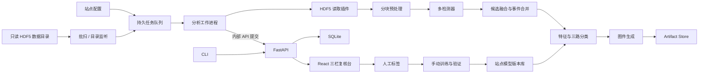

# DAS Sentinel 设计规格

- 日期：2026-07-26
- 状态：已由用户批准
- 工作名：DAS Sentinel
- 目标部署：x86-64 NAS（CPU）或 NVIDIA CUDA 工作站，二者独立运行

## 1. 背景

DAS 数据具有通道密集、采样率高、数据量大、设备和布设差异明显等特点。
井中、城市和海底光缆的信号与噪声分布不同，不能用一套未经校准的阈值或模型
承诺相同准确率。本项目从一个全新仓库实现长期运行的 DAS 事件检测、分类和复核
系统，不修改或依赖 `Z:\das-events-work\das-events` 的代码。

系统首先支持现有 ZD/PRODML 风格 HDF5，以读取器插件边界支持未来格式。首版
同时提供浏览器管理界面和 CLI，支持历史目录批量扫描以及新文件落盘后的准实时
分析。

## 2. 已确认的产品决策

1. 交互：React Web 管理界面 + CLI。
2. 数据：首版完整支持 ZD/PRODML 风格 HDF5；其他格式以后通过插件接入。
3. 运行：离线批量扫描 + 目录监听准实时处理。
4. 标签：`earthquake`、`blast`、`traffic`、`noise`、`unknown`。
5. 初始数据条件：很少或没有人工标签。
6. 分类：物理规则、无监督相似性、监督特征模型三路并行；保留各路证据。
7. 训练：管理员手动触发；验证通过后手动发布；模型可回滚。
8. 多站点：每个站点独立配置数据目录、光缆类型、坐标、频带、阈值和模型。
9. 定位：输出通道范围、沿缆距离、传播方向和表观速度，不反演真实震源坐标。
10. 性能基线：约 1,000 道、1 kHz、每文件 60 秒，目标处理速度快于文件生成速度。
11. 检测策略：平衡召回与误报；证据不足或方法分歧时输出 `unknown`。
12. NAS：x86-64、Docker、至少 8 GB 内存；原始数据以只读卷挂载。
13. GPU：NVIDIA CUDA；不可用或显存不足时回退 CPU。
14. 用户：局域网单管理员，使用简单登录。
15. 界面：采用事件队列、图件和方法证据并列的三栏复核分析台。

## 3. 范围

### 3.1 首版范围

- 多站点配置和启停。
- HDF5 数据发现、校验、分块读取和规范化。
- 历史批量任务和目录监听任务。
- 多检测器并行、候选融合、跨块与跨文件事件合并。
- 五类融合分类及可解释证据。
- 事件瀑布图、Welch PSD、STFT 时频谱和代表波形。
- 人工标签、备注、训练集管理、训练、验证、发布和回滚。
- CPU 和 CUDA 两种独立 Docker 部署。
- 持久任务、失败重试、幂等扫描和完整版本追踪。

### 3.2 明确不在首版

- 多用户角色和审核权限。
- NAS 调度局域网远程 GPU 节点。
- GIS 光缆地图。
- 多阵列震源经纬度和深度反演。
- 秒级采集协议直连。
- HDF5 之外的实际读取器。
- 没有真实标签支撑的深度学习分类器。
- 自动删除原始数据或应用产物。

## 4. 总体架构

采用模块化单体。Web 请求、CLI 和后台工作进程复用同一领域与信号处理代码。
API 与后台工作进程独立运行，避免长分析任务阻塞 API；React 构建产物由 API
直接提供。



### 4.1 运行组件

- `api`：唯一数据库写入者；提供认证、REST API、任务与模型状态。
- `worker`：领取任务、读取原始数据、分析并写入共享 Artifact Store；通过内部
  API 提交结构化结果，不直接打开数据库。
- `web`：React 静态构建产物，由 API 提供；浏览器调用同源 API，不单独运行
  Web 服务。
- `cli`：默认调用 API；测试和单文件诊断可直接调用核心库。

API 固定为单 Uvicorn 进程，并在应用层串行化短写事务。读请求可并行执行。

### 4.2 模块边界

建议代码边界如下：

```text
backend/src/das_sentinel/
  domain/          # 数据对象、状态和纯业务规则
  readers/         # Reader 插件协议与 ZD/PRODML HDF5 实现
  signal/          # 分块、预处理、CPU/CUDA 数组后端
  detectors/       # STA/LTA、能量统计、相干、轨迹/模板
  classifiers/     # 规则、聚类/近邻、监督模型、融合
  artifacts/       # 瀑布、PSD、STFT、代表波形
  services/        # 站点、任务、事件、复核、训练用例
  persistence/     # SQLAlchemy 模型、迁移、仓储
  api/             # FastAPI 路由、认证和内部工作进程 API
  worker/          # 任务领取、心跳、重试和资源控制
  cli/             # 命令行入口
frontend/          # React + TypeScript
tests/             # 单元、集成、端到端和性能基准
```

依赖方向固定为：`api/worker/cli -> services -> domain`；信号算法通过领域接口返回
结果，不引用数据库或 HTTP。

## 5. 规范数据接口

### 5.1 Reader 插件

每个读取器实现：

- `probe(path) -> ProbeResult`：判断格式并读取轻量元数据。
- `read_metadata(path) -> DasMetadata`。
- `read_block(path, sample_start, sample_stop, channel_slice) -> DasBlock`。

`DasBlock` 规范字段：

- `data`：二维 `float32`，固定为 `[time, channel]`。
- `start_time_utc`：带时区 UTC 时间。
- `sample_rate_hz`。
- `channel_distance_m`：一维、长度与通道数一致。
- `unit`：原始测量单位；未知时明确记录 `unknown`。
- `source_path`、`source_sample_start`、设备元数据。

### 5.2 首版 HDF5

默认读取：

- `Acquisition/Raw[0]/RawData`
- `Acquisition/Raw[0]/RawDataTime`

采样率、道间距、标距、起始通道和测量时间优先使用 HDF5 属性，文件名仅作后备。
读取器检查数据方向；若源数据为 `[channel, time]`，在返回规范块时转换。任何
单位或时区推断都写入读取审计信息，不静默猜测。

### 5.3 时间规则

- 数据库统一存 UTC。
- 站点保存 IANA 时区和数据原始时钟偏移。
- 文件名、HDF5 属性和时间数组不一致时，以站点配置指定的优先级处理，并产生
  警告证据。
- Web 同时显示 UTC 和站点本地时间。

## 6. 领域数据

核心实体：

- `Site`：站点、光缆类型、数据根目录、时区、通道几何。
- `ProcessingProfile`：预处理、检测、融合和图件参数的不可变版本。
- `SourceFile`：路径、大小、修改时间、指纹、元数据和处理状态。
- `Job`：批扫或监听任务，包含状态、进度、重试和心跳。
- `ProcessingRun`：一次文件分析，绑定流水线、配置和执行后端版本。
- `DetectionEvidence`：单检测器候选、分数、时间距离范围和方法专属指标。
- `Event`：融合后的稳定事件标识、时间距离范围、源文件集合。
- `ClassificationResult`：各方法输出、融合标签、决策分和理由。
- `Review`：人工标签、备注、时间和被复核的预测版本。
- `ModelVersion`：训练数据快照、特征定义、验证指标、状态和模型文件。
- `Artifact`：瀑布、PSD、STFT、代表波形及其参数和校验和。

机器预测和人工复核分别追加保存，绝不互相覆盖。事件 ID 在同一站点和流水线版本
中稳定；重新处理生成新的 `ProcessingRun`，并保留与旧事件的关联。

## 7. 文件发现和幂等

### 7.1 稳定文件

目录监听发现文件后，只有满足以下条件才入队：

1. 两次轮询之间大小和修改时间不变。
2. HDF5 能打开且关键数据集可读取。
3. 数据形状、采样率和时间范围有效。

默认轮询间隔 5 秒，稳定等待 10 秒。未稳定文件保持 `pending`，不计失败。

### 7.2 指纹

`site_id + 规范绝对路径 + 文件大小 + mtime_ns` 组成快速指纹。相同指纹和相同
处理配置跳过；文件内容发生变化或配置版本变化时产生新运行。完整文件哈希不作为
默认路径，以免对大型 NAS 数据重复产生高 I/O。

### 7.3 任务恢复

- `queued`、`running`、`succeeded`、`failed`、`cancelled` 为持久状态。
- 工作进程定期提交心跳和进度检查点。
- API 启动时把超过心跳期限的 `running` 任务退回 `queued`。
- 已完成文件由运行键跳过。
- 单文件失败不阻塞同任务的后续文件。

## 8. 信号处理

### 8.1 分块

默认按 20 秒时间块处理，相邻块重叠 5 秒；块大小可由站点配置调整。重叠区只在
事件合并后输出一次。以 1,000 道、1 kHz 为例，单个原始块约 80 MB，可控制
中间数组峰值。

### 8.2 预处理

顺序固定为：

1. 有限值检查和单位规范。
2. 每道去均值、线性去趋势。
3. 坏道标记：常数道、非有限值、相对全站中位数的极端 RMS。
4. 可配置的跨道稳健中位数共模抑制。
5. 按检测器使用零相位或等效零相位带通。
6. 使用稳健尺度标准化；不以单个极值决定整块尺度。

坏道只从算法输入中屏蔽，不修改原始数据。

### 8.3 检测器

所有检测器返回同一 `Candidate`：
`time_start/end/peak`、`distance_min/max`、归一化分数、质量标志和方法证据。

1. **STA/LTA 多道符合**
   - 捕获地震初至和爆破等短时冲击。
   - 在抽取通道上逐道触发，要求最小空间符合。
   - 单道毛刺和文件滤波边缘不形成事件。

2. **多频带能量与统计检测**
   - 使用 RMS、峰度、峰均比、谱熵和频带能量比。
   - 补充缓起、持续或单一 STA/LTA 不敏感的事件。

3. **空间相干和 slant-stack**
   - 在多个表观慢度上计算跨道相干。
   - 输出最佳慢度、表观速度和传播方向。
   - 扣除通道数相关噪声底，并对近零慢度共模设置质量标志。

4. **轨迹和模板**
   - 对城市光缆的时距域线状能量使用 Hough 类轨迹评分，提取方向和速度。
   - 模板匹配仅在管理员从已确认事件创建模板后启用。
   - 模板按站点和处理配置版本隔离。

### 8.4 平衡融合

- 每个检测器先使用站点配置的普通阈值和强阈值。
- 两个普通阈值候选在时间与距离上相交，或一个候选达到强阈值且通过物理质量
  检查时，进入事件列表。
- 单个弱候选保留在运行审计中，但默认不进入待复核队列。
- 时间相邻且距离重叠的候选合并；跨块和跨文件使用相同规则。
- 合并保留所有原始证据，不只保留最高分检测器。

## 9. 分类

### 9.1 特征

事件特征覆盖：

- 时间：持续时间、上升时间、脉冲数、脉冲间隔、昼夜时间。
- 频率：主频、带宽、Welch PSD、频带能量比、谱质心和谱熵。
- 空间：沿缆范围、能量重心、浅/深段能量比、连续性。
- 传播：最佳慢度、表观速度、方向、相干度、近零慢度标志。
- 统计：RMS、峰度、峰均比、跨道相关、重复率。
- 上下文：站点、光缆类型和设备配置，不使用源文件路径作为学习特征。

### 9.2 三路方法

1. **物理规则评分**
   - 始终可用。
   - 每个标签得到分数和理由；规则参数按站点版本化。
   - 规则用于初始分类和监督模型的安全护栏。

2. **无监督相似性**
   - 对标准化特征运行 HDBSCAN，并维护最近邻索引。
   - 输出簇、离群分和相似已复核事件。
   - 簇编号不是业务标签，不能直接写成地震、爆破或车流。

3. **监督特征模型**
   - 使用带类别权重的随机森林作为首个监督模型。
   - `unknown` 是融合层的拒判结果，不作为训练类别。
   - 每个站点的四个实体类别各至少有 20 个已复核事件，并能按事件日期形成分组
     验证时，才允许训练可发布模型。

### 9.3 验证和发布

- 数据按事件日期和源文件组划分，禁止同一物理事件泄漏到训练与验证两侧。
- 报告宏平均 F1、逐类 precision/recall、混淆矩阵和规则基线。
- 默认发布门槛：宏平均 F1 不低于 0.70、任何实体类别 recall 不低于 0.50，
  且不劣于当前已发布模型。
- 训练完成只产生 `candidate` 模型；管理员查看报告后手动发布。
- 发布为原子切换；旧模型仍可回滚。

### 9.4 决策融合

- 无监督方法只提供相似性和离群证据，不直接投票标签。
- 没有监督模型时，融合结果来自物理规则。
- 有已发布监督模型时，默认使用 `0.35 × 规则分 + 0.65 × 校准模型分`。
- 最高融合分低于 0.60，或前两类分差小于 0.15，输出 `unknown`。
- 明确的共模、坏道或边缘质量标志可以降级为 `noise` 或 `unknown`，不能被高模型
  分静默覆盖。
- 界面把融合分称为“决策分”；只有经过概率校准的监督输出才称为“概率”。

## 10. 图件

每个进入复核队列的事件生成：

1. 瀑布图：距离 × 时间，原始和滤波版本，稳健百分位色标。
2. Welch PSD：代表波束与选定距离段，标注主频和配置频带。
3. STFT：代表波束时频能量，使用与事件持续时间匹配的窗长。
4. 代表波形：稳健跨道波束，并标注候选起止、峰值和脉冲。
5. 证据 JSON：全部检测器、特征、规则、模型和质量标志。

图件包含 UTC、站点本地时间、距离单位、采样率、处理配置和模型版本。Web 提供
全屏查看和下载；首版不在浏览器中重新计算原始 DAS 数据。

## 11. Web 与 CLI

### 11.1 Web 页面

- 登录/管理员初始化。
- 总览：监听状态、队列、处理延迟、今日事件和分类分布。
- 站点：创建、编辑、启停和配置版本。
- 任务：批扫、监听、暂停、恢复、取消和失败文件重试。
- 事件：三栏复核分析台、筛选、标签、备注和相似事件。
- 模型：标签统计、训练、验证报告、发布和回滚。

### 11.2 CLI

首版命令：

```text
das-sentinel admin init
das-sentinel site add|list|show
das-sentinel scan SITE_ID [PATH]
das-sentinel watch SITE_ID
das-sentinel jobs list|show|retry|cancel
das-sentinel events export
das-sentinel train SITE_ID
das-sentinel models list|publish|rollback
das-sentinel benchmark FILE
das-sentinel doctor
```

写操作通过 API 执行。`benchmark` 和 `doctor` 可直接在容器中运行。

## 12. API 与安全

- REST API 使用 `/api/v1` 前缀；OpenAPI 由 FastAPI 生成。
- 浏览器使用带 `HttpOnly`、`SameSite=Strict` 的安全会话 Cookie。
- 管理员密码使用 Argon2id 哈希。
- 所有写请求要求同源 CSRF 令牌。
- 初始管理员通过 CLI 创建，不提供默认密码。
- 内部工作进程令牌由 Docker secret 或环境文件注入，不写入镜像和日志。
- 原始数据卷对 API 和工作进程均为只读。
- 局域网 TLS 终止由 NAS 反向代理负责；应用同时支持直接 HTTP 供受信网络测试。

## 13. 持久化和 Artifact Store

- SQLite 保存结构化数据；Artifact Store 保存 PNG、JSON 和模型文件。
- SQLite 文件位于部署主机本地应用卷，不位于 SMB/NFS。
- 使用 WAL、`busy_timeout` 和定期检查点；运行时 SQLite 必须为 3.51.3 或包含
  WAL-reset 修复的回移版本。
- 即使数据库支持 WAL，应用仍保持单写入者，避免写入竞争。
- Artifact 路径由数据库 ID 派生，用户输入不直接参与路径拼接。
- 模型和图件保存 SHA-256，以发现不完整复制或磁盘损坏。

## 14. 错误处理

- 未写完文件：保持 `pending` 并延迟重试。
- 损坏 HDF5/缺失元数据：有限次数指数退避后标为 `failed`，队列继续。
- 内存不足：减小块尺寸重试一次；仍失败则记录明确错误。
- CUDA 不可用或显存不足：清理设备缓存并回退 CPU，记录实际后端。
- 配置无效：创建配置版本前拒绝，旧版本继续生效。
- 模型加载失败：回退最近可验证模型；若无模型则只使用规则。
- 图件生成失败：事件仍保存，Artifact 标为失败并可单独重试。
- 数据库或 Artifact Store 不可写：健康检查失败并停止领取新任务。

日志为结构化 JSON，至少包含站点、任务、运行、文件、事件和流水线版本 ID；不得
记录密码、令牌或原始信号数组。

## 15. 部署

提供：

- `compose.yaml`：API（内含 React 静态资源）、共享应用卷和健康检查。
- `compose.cpu.yaml`：CPU 工作进程，NAS 默认并发 1。
- `compose.gpu.yaml`：CUDA 工作进程，GPU 默认并发 1。
- `.env.example`：路径、时区、监听和资源参数，不含秘密。

CPU 镜像不包含 CuPy/CUDA。GPU 镜像使用稳定的 `cupy-cuda12x` 并通过 Compose
预留 NVIDIA GPU；宿主机需安装兼容驱动和 NVIDIA Container Toolkit。两种配置
均可在单机独立运行，不实现跨主机任务调度。

默认资源策略：

- 时间块 20 秒，重叠 5 秒。
- NAS 分析并发 1，可通过已验证的环境参数增加。
- GPU 并发 1，避免多进程争抢显存。
- 工作进程只预取下一个文件。
- 图件在事件确认进入复核队列后生成，弱审计候选不出图。

## 16. 测试

### 16.1 单元测试

- HDF5 方向、元数据、时间偏移、通道距离和分块读取。
- 预处理对常数道、NaN、共模、边缘和已知频率的行为。
- 四个检测器的合成正例与反例。
- 跨块/跨文件合并、去重和稳定 ID。
- 规则评分、聚类语义、拒判和模型发布门槛。
- 图件尺寸、坐标、元数据和输出完整性。

### 16.2 集成测试

- API 创建站点和任务，工作进程领取并提交结果。
- 目录监听只处理稳定文件。
- 进程中断后任务恢复。
- 损坏文件隔离、重试和后续文件继续。
- 人工标签、训练、验证、发布和回滚全流程。
- CPU/GPU 数值一致性；无 GPU 环境验证自动回退。

### 16.3 前端和端到端测试

- React 组件测试覆盖筛选、状态、图件切换和标签表单。
- 浏览器端到端测试覆盖登录、建站点、扫描、复核、训练报告和模型发布。
- Docker 健康检查覆盖 API、工作进程、数据库和 Artifact Store。

### 16.4 真实数据与性能

- 使用现有井中 HDF5 进行只读冒烟测试，核对时间、距离、事件图件和处理恢复。
- 使用合成的地震、爆破、车辆轨迹、共模噪声、单道毛刺和边界事件做确定性回归。
- 在 4 CPU、4 GB 工作内存限制下，约 1,000 道 × 1 kHz × 60 秒文件平均处理
  时间目标小于 60 秒。
- GPU 基准记录设备、CPU 时间、GPU 时间、峰值内存和加速比；不同 GPU 不设虚假
  的统一倍数门槛，但必须证明实际执行 CUDA 路径且结果与 CPU 一致。

## 17. 验收条件

以下全部满足才视为首版完成：

1. 全部单元、集成、前端、端到端和 Docker 测试通过。
2. 现有 HDF5 可批扫和监听，事件跨文件不丢失、不重复。
3. 每个复核事件有瀑布、PSD、STFT、波形和可解释证据。
4. CPU 与 CUDA 结果在规定数值容差内一致；GPU 故障能回退。
5. 基线 CPU 性能和工作内存达到第 16.4 节目标，或明确记录硬件差异和瓶颈。
6. 重启续跑、失败隔离、幂等和版本追踪通过故障注入测试。
7. 原始数据只读挂载；没有代码路径会移动、改名或删除原始文件。
8. 模型发布门槛、人工确认和回滚实际可用。
9. 安装文档能让新的 x86-64 Docker 主机分别启动 CPU 或 GPU 配置。

## 18. 科学边界

- 井中、城市和海底光缆具有显著域差异；站点阈值和模型默认隔离。
- 在取得真实城市或海底样本前，只能验证格式、算法实现和合成行为，不能声称真实
  分类准确率。
- `unknown` 是必要结果，不是系统失败；它防止无标签阶段产生虚假确定性。
- 沿缆距离和表观速度不等于真实震源位置。
- 后续引入深度模型必须单独设计数据集、泄漏防护、算力和部署规格。

## 19. 技术依据

- DAS 特征方法、小样本限制与空间相似性：
  <https://academic.oup.com/gji/article/240/1/462/7833573>
- DAS 车流时距轨迹与传统分类：
  <https://pmc.ncbi.nlm.nih.gov/articles/PMC10059793/>
- 无干净标签的 DAS 弱监督降噪及算力表现：
  <https://academic.oup.com/gji/article/236/2/1026/7453669>
- Docker Compose GPU：
  <https://docs.docker.com/compose/how-tos/gpu-support/>
- CuPy CUDA 安装：
  <https://docs.cupy.dev/en/stable/install.html>
- SQLite WAL 限制与并发：
  <https://sqlite.org/wal.html>
