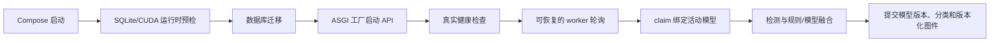

# DAS Sentinel 稳定化与优化设计

- 日期：2026-08-06
- 状态：已由用户分节批准
- 基线提交：`cc55acaf8c25ba8a994156b4c674132c1ed4641d`（`v0.1.0`）
- 目标分支：`feature/das-sentinel-hardening`
- 目标部署：x86-64 NAS（CPU）或 NVIDIA CUDA 工作站，二者独立运行

## 1. 背景与审计结论

本设计针对 GitHub 仓库 `yjianggeo/das-sentinel` 的 `v0.1.0` 做稳定化、功能补全和性能优化。现有模块边界总体合理，因此不重写 FastAPI、worker、SQLite、React 或检测算法架构，只修复有复现证据的问题。

审计基线如下：

- 安全 SQLite 3.53.1 环境下，Python 测试为 562 通过、3 跳过、1 个性能用例按配置未选择。
- 标准 Python 3.12.13 的 SQLite 3.50.4 环境有 3 个预期安全门禁失败；门槛不能降低。
- 前端 11 个测试通过，TypeScript/Vite 生产构建通过，Ruff 通过。
- 1000 通道 × 1000 Hz × 60 秒 CPU 基线两次为 61.17 秒和 66.44 秒，均值 63.80 秒，峰值 RSS 988.3 MB；内存达标，速度未达到小于 60 秒目标。
- 同一提交在本地磁盘约 6 秒完成测试收集，而 NAS 工作树 60 秒仍未完成收集；NAS 全量重复测试在 15 分钟上限内未结束。代码和测试工作树应优先位于本地磁盘，NAS 主要承载只读原始 DAS 数据。

阻断性问题包括：Docker ASGI 目标不存在、宿主数据路径覆盖容器路径、SQLite 镜像不满足安全门槛、GPU 运行时缺少 CuPy JIT 所需头文件、worker 短暂断网后退出、已发布监督模型不参与推理、真实特征使相似检索和训练失败、不同 profile 重扫发生图件冲突。

## 2. 范围和阶段

### 2.1 第一阶段：部署与核心正确性

第一阶段必须形成两个闭环：

1. CPU Compose 从空卷完成 SQLite 预检、迁移、API 启动、真实健康检查、管理员初始化和 worker 领取任务。
2. 已发布监督模型从 claim 快照开始，经过安全加载、事件推理、融合、worker result、数据库记录和 evidence artifact，完整贯通且版本一致。

同时修复真实特征、profile 图件命名空间、文件尾 energy 事件、worker 恢复、错误复核和复核重复提交。

### 2.2 第二阶段：性能与前端完善

第一阶段全量验证通过后，再优化共享预处理和 FFT，随后处理前端分页、错误状态、认证状态、时区统计、键盘可访问性和 artifact 加载错误。

### 2.3 非目标

- 不引入远程 GPU 集群、消息队列、PostgreSQL、多管理员角色或 GIS。
- 不扩展到 ARM NAS；原设计的 x86-64 NAS 支持边界不变。
- 不降低 SQLite WAL-reset 安全门槛。
- 不为了清零当前不可利用的 React Router RSC 告警而直接升级大版本。
- 不在未取得真实标注数据时声明城市或海底光缆分类准确率。

## 3. 总体数据流

API 仍是唯一 SQLite 写入入口。worker 只读取 `/data` 下的原始 HDF5 和 `/app-data/artifacts/models` 下经过约束的模型 bundle，通过内部 API 提交结果。原始数据卷继续只读挂载。

## 4. 部署与运行时设计

### 4.1 ASGI 工厂与启动顺序

新增零参数 `create_runtime_app()`，由环境构造 `Settings` 并调用现有 `create_app(settings)`。入口改为 Uvicorn `--factory`，避免模块导入时读取密钥或创建数据库连接。

容器启动顺序固定为：

1. 针对实际选中的 DB-API 驱动验证 SQLite 版本。
2. 版本安全后运行 Alembic 迁移。
3. 启动 Uvicorn 工厂。
4. lifespan 再验证数据库 PRAGMA、artifact 根和数据根。

低版本 SQLite 不得先执行迁移或管理员初始化写入再失败。

### 4.2 可复现的安全 SQLite

移除会解析到 SQLite 3.51.1 的无界 `pysqlite3-binary` 运行依赖。CPU 镜像在 builder 阶段使用带 SHA-256 校验的官方 SQLite 3.53.3 amalgamation，静态构建 Python 3.12 对应的 `pysqlite3` wheel。运行阶段只复制 wheel，不保留编译器和源码。

镜像构建时执行 `SELECT sqlite_version()`，启动预检再次验证。Windows 本地开发若使用不安全 SQLite，`doctor` 和真实启动继续失败；单元测试通过依赖注入覆盖正向版本分支，不能把不安全版本加入白名单。

### 4.3 Compose 环境与密钥

- `.env` 中宿主数据路径重命名为 `DAS_HOST_DATA_ROOT`，仅用于 Compose bind source。
- 容器显式设置 `DAS_DATA_ROOT=/data`。
- API、CPU worker 和 GPU worker设置 `restart: unless-stopped`。
- 默认端口绑定 `127.0.0.1:${DAS_HTTP_PORT:-8000}:8000`；局域网访问由 NAS HTTPS 反向代理提供。
- `change-me-*`、空值和已知示例密钥均不能通过启动校验。
- 文档明确管理员初始化、密码轮换、NAS ACL、备份、恢复和首次启动顺序。

### 4.4 健康检查

新增无认证 `/healthz` JSON 路由。它验证数据库连接和关键 PRAGMA、artifact 根可写、数据根可读；失败返回非 2xx，不暴露路径、密钥或数据库细节。

Compose 健康命令同时校验 HTTP 状态和 JSON `status=ok`。未知 SPA 路径不能再被当作健康结果。

### 4.5 Worker 恢复

worker 永久循环按错误类型处理：

- transport error、超时和 5xx 使用 1、2、4、8、16、30 秒上限的指数退避；成功请求后重置。
- 401、令牌错误、严格 schema 错误和协议冲突立即失败，避免错误配置无限重试。
- 每次 claim 在同一个 API 写协调锁和数据库事务内先回收超时任务，再领取最早 queued 任务。
- worker 重启后自动继续轮询；任务达到最大尝试次数才进入不可重试失败。

这使“worker 崩溃但 API 未重启”的任务也能恢复。

### 4.6 GPU 运行时

第一阶段使用固定 CUDA 12.8 `devel` 基础镜像，确保 CuPy NVRTC/JIT 所需头文件和运行库齐全。镜像较大是有意的正确性权衡；裁剪成 runtime 镜像属于后续优化。

GPU worker 在领取任务前执行一次小型 CuPy 数组、FFT、回传 NumPy和设备同步冒烟。无法执行真实 CUDA 核心时启动失败，不以 `getDeviceCount()` 代替运行验证。

## 5. 模型推理与结果版本

### 5.1 Claim 模型快照

新增数据库迁移，为 Job 保存 nullable `model_version_id`。claim 时在事务内选择站点当前 active 模型，并冻结：

- 模型数据库 ID；
- 站点模型版本；
- bundle 路径；
- bundle SHA-256。

无 active 模型时这些字段为空，规则法保持可用。模型在任务执行期间即使被回滚，当前任务仍使用 claim 时绑定版本。

### 5.2 Worker 安全加载

worker 将模型路径解析后限制在 `/app-data/artifacts/models` 下，要求是常规文件，执行已有大小、压缩包和 SHA-256 检查，然后只加载一次。API completion 必须校验提交的模型 ID 与 Job 快照一致。

已绑定模型损坏、被替换或推理失败时，任务以 `invalid_model` 失败。不得静默改为规则法并生成看似成功的结果。

### 5.3 Pipeline 融合与持久化

每个事件始终计算规则分。有模型时调用现有 `ModelBundle.predict_probabilities()`，把概率传入融合器；无模型时传入 `None`。

以下位置必须记录同一个模型身份和输出：

- `ProcessingRun.model_version_id`；
- `Classification.model_version_id` 与 `method`；
- worker result payload；
- evidence JSON 中的模型版本、概率和融合理由；
- 图件版本说明。

method 只允许反映真实执行路径：无模型为 `rules`，有模型为 `fusion`。

## 6. 数据与事件身份修复

### 6.1 真实特征

相似检索和训练保留反序列化后的完整特征 mapping，不再对所有值预先调用 `float()`。现有 `FeatureVectorizer` 负责排除 `site_id`、`cable_type`、`device_config`，并只接受批准的数值字段。

训练和相似检索测试必须使用真实 `extract_features()` 输出，覆盖字符串上下文和数值字段。

### 6.2 Profile 专属事件与图件

`processing_profile_id` 加入 UUID5 事件身份输入。新的身份组成至少包含站点、不可变 profile ID、pipeline version、源指纹、峰值样本和通道区间。

该决策覆盖原设计中不包含 profile ID 的事件 UUID 规则。数据库事件本来就隶属于不同 processing run，因此不会合并或重写既有复核记录；同一 profile 的重复执行仍保持确定性和幂等。

### 6.3 文件尾 Energy 事件

移除 `active[-window:] = False`。RMS 数组中的这些位置已有完整窗口，跨块归属继续由 pipeline 的 canonical peak 区间控制。回归测试覆盖中间事件、块边界事件和文件最后一个 energy window。

## 7. 前端数据完整性

### 7.1 事件详情竞态

每次选择事件都创建新的请求序号和 `AbortController`。detail 和 similar 只有在请求仍是最新选择时才能写入状态；切换和卸载取消旧请求。复核表单目标必须同时匹配当前 selected ID 和 detail ID。

### 7.2 Review 幂等

复核表单提交期间立即进入 busy 状态并阻止重入。每次新的用户提交生成 UUID 请求 ID；同一网络重试复用该 ID。

新增数据库迁移，为 Review 保存 nullable `request_id`，并建立 `(event_id, request_id)` 唯一约束。API 对重复请求返回既有 review；用户修改后产生新的请求 ID，仍追加新的审计记录。旧 review 的空 request ID 保持兼容。

## 8. 第二阶段性能优化

性能优化保持检测逻辑和数值输出不变：

1. 每个逻辑源块只执行一次坏道识别、有限值清洗、线性去趋势和共模去除。
2. 对相同源块只计算一次前向 FFT；每个检测频带分别应用增益、逆 FFT 和稳健尺度归一化。
3. 保持 STA/LTA 历史块与其他检测器逻辑块的边界差异，不能错误共享不同时间范围的频谱。
4. CPU/CUDA 核心继续满足 `rtol=1e-4, atol=1e-5`，候选、事件 UUID、标签和 artifact 输入保持一致。

每次改动运行完整 1000 × 1000 Hz × 60 秒基线。若共享预处理后仍未达到小于 60 秒，再单独设计 coherence moveout 优化；不预先重写最复杂检测器。

## 9. 第二阶段前端完善

- 事件筛选下推 API，并增加分页或加载更多，避免最近 100 条切片隐藏旧未复核事件。
- loading、error、empty 和 retry 使用明确状态，错误不能被加载页面遮住。
- API 集中处理会话中途 401；logout 失败不能让客户端伪装成已退出。
- Dashboard 使用后端区间聚合和站点时区，不从最近 100 条推算“今日事件”。
- Artifact tabs、fullscreen 和确认对话框实现标准键盘和焦点管理。
- 图件加载、401、409 完整性失败和重试均有可见错误状态。

React Router 7.18.2 的 GHSA-qwww-vcr4-c8h2 仅影响未使用的 unstable RSC API。当前 BrowserRouter + FastAPI REST 路径记录安全例外，并禁止在未升级前引入 RSC；大版本升级必须单独验证。

## 10. 测试与 CI

### 10.1 TDD 回归

每个问题先增加最小失败测试，再修改生产代码。至少覆盖：

- Uvicorn factory 可导入并从临时空卷启动；
- 低版本 SQLite 在迁移前失败，安全静态驱动通过；
- Compose 最终容器环境为 `/data`，宿主路径只参与 bind；
- `/healthz` 返回 JSON 且依赖失败时非 2xx；
- worker transport/5xx 退避、401 快速失败、运行期 stale recovery；
- 训练、发布、claim、模型推理、融合、持久化和 evidence 完整链；
- 模型替换或损坏安全失败；
- 真实字符串上下文特征可训练和相似检索；
- profile v1/v2 重扫均成功且图件互不覆盖；
- 文件尾 energy 事件可检出；
- 事件详情逆序响应不会错绑复核；
- 双击和网络重试只产生一个 review。

### 10.2 GitHub Actions

新增以下门禁：

- Python 3.12 + 安全 SQLite：Ruff、全量 Pytest、`pip check`；
- 前端：`npm ci`、Vitest、TypeScript/Vite build；
- CPU Docker：build、Compose config、空卷启动、迁移、健康检查和管理员初始化；
- GPU 镜像：至少完成 build；真实 CUDA 冒烟在目标 GPU 验收机执行。

Mypy 的 64 项存量问题不直接成为本次阻断门禁。本次修改涉及的类型错误必须消除，存量治理另开范围。

### 10.3 验证诚实性

没有 Docker 或 GPU 的开发机只能报告静态配置和非容器测试。CPU 容器、GPU 核心、NAS ACL、只读原始数据哈希、冷备份恢复和故障注入必须在相应环境取得真实输出后才能声明通过。

## 11. 错误分类

- `unsafe_sqlite`：启动前失败，不迁移、不写入。
- `invalid_model`：Job 失败且不可静默降级，并标记为不可自动重试。运维人员修复或重新发布模型后，显式新建 Job，使其在下一次 claim 时获得新的模型快照。
- `source_changed` / `invalid_claim`：不可重试，要求重新扫描生成新指纹。
- transport error / 5xx：worker 循环重试，不立即改变已领取任务结果；心跳超时后由 claim 恢复。
- 401 / 协议错误：worker 进程快速失败，交给容器重启和运维修正配置。
- artifact conflict：同一 profile 的不同内容仍视为完整性错误；不同 profile 通过新身份隔离。

## 12. 完成标准

以下全部满足才完成本轮工作：

1. CPU Compose 可从空卷真实启动，健康检查和管理员初始化通过。
2. 容器实际 SQLite 版本安全，低版本在任何迁移写入前失败。
3. worker 可在 API 短断、进程崩溃和心跳超时后恢复。
4. 已发布模型真正参与新任务推理，所有结果位置记录同一模型版本。
5. 真实事件特征可用于相似检索和训练，不返回 500。
6. 同一源使用新 profile 重扫成功且 artifact 不冲突。
7. 文件尾 energy 事件、详情竞态和 review 幂等回归通过。
8. Python、前端、CI 和 CPU 容器测试全部通过。
9. CPU 基线峰值 RSS 小于 4 GB，平均处理时间小于 60 秒；否则必须继续按热点优化，不以硬件差异代替目标。
10. 真实 GPU 环境完成 CuPy FFT、CPU/CUDA 数值一致性和故障回退验证后，才声明 GPU 完成。

## 13. 参考资料

- SQLite WAL 与 WAL-reset bug：<https://sqlite.org/wal.html#the_wal_reset_bug>
- SQLite 3.53.3：<https://sqlite.org/releaselog/3_53_3.html>
- CuPy CUDA 安装：<https://docs.cupy.dev/en/stable/install.html>
- Docker Compose 环境变量：<https://docs.docker.com/compose/how-tos/environment-variables/set-environment-variables/>
- React Router RSC 公告：<https://github.com/advisories/GHSA-qwww-vcr4-c8h2>
